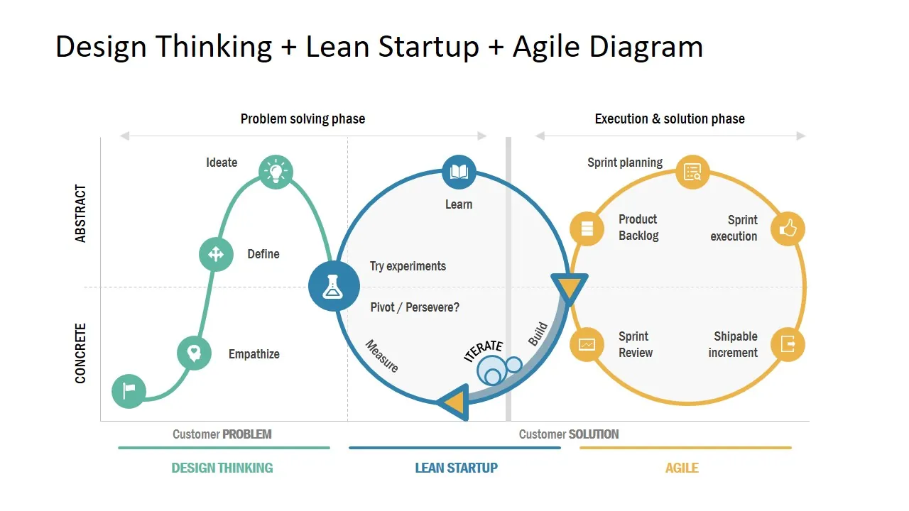

# Lean Startup: what it is and how we apply it at MARCO

Starting a business means having ideas, enthusiasm and the drive to turn them into something real. But what happens when we're so focused on building our product that we forget to ask whether the market actually needs it?

That's exactly how MARCO began: a team full of ideas, expertise and motivation, making a mistake many startups make — building the roof before laying the foundations. We focused on creating what we thought would be the best travel-planning tool without spending enough time listening to the people who would actually use it.

Joining the tourism accelerator [Turislab](https://turislab.gal/) was a turning point. We realised that entrepreneurship isn't just about building a great product. It's also about questioning our assumptions, running experiments and learning directly from the market.

That's where the <strong style="color: #ff7f50ff;">Lean Startup methodology</strong> comes in. It's helping us rethink how we develop MARCO and how we make decisions about its future.

&nbsp;

## What is the Lean Startup methodology?

The Lean Startup methodology, popularised by entrepreneur [Eric Ries](https://theleanstartup.com/principles), offers a different approach to building a business. Instead of spending months developing a product based purely on our instincts, it encourages us to test early whether our ideas address real market needs.

Its philosophy is built around <strong style="color: #ff7f50ff;">validated learning</strong>: make assumptions explicit, test them and use the evidence to choose what to do next. The best-known framework for this is the continuous Build, Measure, Learn loop.

For us, Lean Startup raised a fundamental question. We had spent a lot of time imagining new features for MARCO. But were those really the features our future users needed?

Before building our idea of the perfect travel planner, we needed to go out and listen.

&nbsp;

## How does Lean Startup work? Key stages and tools

The **Build → Measure → Learn** cycle isn't about launching a perfect product on the first attempt. It's about reducing uncertainty through small experiments and using what we learn to make better decisions.

The following diagram places the Lean Startup cycle within a broader innovation process, alongside Design Thinking and agile development.

### · Build: turn ideas into hypotheses

We start by asking what we want to validate and what the simplest useful test would be. That doesn't always mean coding a full feature: a demo, a prototype or a **minimum viable product (MVP)** can help gather initial feedback.

At MARCO, we're working with demos and MVPs of key features, alongside hypotheses about how people plan their trips and which problems they encounter along the way.

### · Measure: listen to the market

Next, we put those hypotheses to the test. We're conducting **B2C interviews** with travellers, **B2B interviews** with tourism professionals, **social media surveys** and experiments through **social media campaigns**.

Each activity answers a different kind of question: some reveal unmet needs, others show how people respond to a concept, and others help us explore interest in the product.

### · Learn: decide what to improve, change or drop

The final stage is the most important: interpreting the evidence without looking only for results that support what we already believe.

For MARCO, that means being willing to adjust our messaging, onboarding and development priorities. <strong style="color: #ff7f50ff;">Every experiment should inform a decision</strong>, and every decision can lead to another round of learning.

&nbsp;

## What are the benefits of Lean Startup for a startup?

This approach doesn't remove all the risks of entrepreneurship, but it does help us face them with more evidence and fewer assumptions. Its main benefits include:

- **Understanding the market:** learning how potential customers behave, what frustrates them and which needs remain unmet.
- **Reducing risk:** avoiding months of work on solutions that might attract little interest.
- **Making better use of resources:** focusing time and effort on ideas with a stronger chance of delivering value.
- **Adapting quickly:** recognising when to improve an idea or change direction.

At MARCO, the biggest benefit has been understanding our market. We've gone from imagining how people organise their trips to asking them directly.

That simple shift is changing how we look at our own product.

  <a
    href="https://marcotravel.io/"
    style="
      display: inline-block;
      min-width: 260px;
      background-color: #2563eb;
      color: #ffffff;
      text-decoration: none;
      padding: 18px 36px;
      border-radius: 999px;
      font-weight: 700;
      font-size: 18px;
      line-height: 1.2;
      text-align: center;
      box-shadow: 0 6px 18px rgba(37, 99, 235, 0.18);
    "
  >
    Discover how MARCO works
  </a>

&nbsp;

## From theory to practice: how we're applying Lean Startup at MARCO

Since joining Turislab, we've launched several activities to better understand our market. We're not just trying to prove that MARCO is a good idea. We want to discover which problems are worth solving, for whom and in what way.

That's why we're exploring two complementary perspectives: people planning their own trips (B2C) and tourism professionals and organisations (B2B).

### B2B: opportunities to support local tourism

Our interviews with tourism professionals and organisations have highlighted an interesting opportunity: **reducing seasonality and offering local experiences and nearby activities outside peak travel periods**.

That has led us to explore how MARCO could help people discover local routes, activities and experiences throughout the year, giving smaller destinations and businesses more visibility.

We're still investigating this opportunity. But it shows how listening to the market can uncover possible business directions that weren't central to our original idea.

### B2C: what we're learning from travellers

Our interviews with travellers have also revealed several recurring patterns among the people we've spoken to:

- **Artificial intelligence is already widely accepted** as a tool for researching and organising trips.
- **Social media is a major source of inspiration** for discovering destinations and experiences.
- **Trip planning still relies on multiple tools:** people combine search engines, maps, social media, chats and apps to plan and manage their travels.
- **Information overload and concerns about reliability** are among the most common frustrations.

One discovery has been particularly important for our own value proposition: people understand the benefits of a standalone trip planner more readily than its collaborative features, whose value isn't immediately as clear.

Does that mean we should give up on collaboration? Not necessarily. It means leading with independent trip planning in our messaging and onboarding, while continuing to explore when and how group planning can deliver the most value.

This is precisely the learning we were looking for: not a set of flattering answers, but insights that can genuinely change our decisions.

&nbsp;

## What have we learned so far?

If this experience has taught us anything, it's that entrepreneurship isn't about having all the answers. It's about learning to ask the right questions.

We still have a lot to learn. We'll keep exploring opportunities, testing hypotheses and adapting the product to the real needs of travellers and tourism professionals.

Our goal hasn't changed: making trip planning easier, more intuitive and more enjoyable. What's changing is the path we're taking to get there.

How do you organise your trips? We'd love to hear about your experience and keep learning from the people on the other side of the screen.

  <a
    href="https://marcotravel.io/"
    style="
      display: inline-block;
      min-width: 260px;
      background-color: #2563eb;
      color: #ffffff;
      text-decoration: none;
      padding: 18px 36px;
      border-radius: 999px;
      font-weight: 700;
      font-size: 18px;
      line-height: 1.2;
      text-align: center;
      box-shadow: 0 6px 18px rgba(37, 99, 235, 0.18);
    "
  >
    Try MARCO and share your feedback
  </a>

