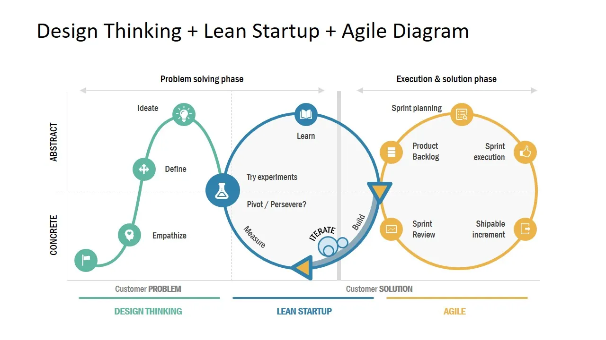

# Lean Startup: qué es y cómo lo aplicamos en MARCO

Emprender es tener ideas, ilusión y muchas ganas de convertirlas en realidad. Pero ¿qué ocurre cuando estamos tan centrados en desarrollar nuestro producto que nos olvidamos de preguntarnos si el mercado realmente lo necesita?

En MARCO comenzamos precisamente así: con un equipo lleno de ideas, conocimientos y motivación, pero cometiendo un error bastante habitual entre las startups: empezar la casa por el tejado. Nos centramos en construir lo que creíamos que sería la mejor herramienta para planificar viajes, sin dedicar suficiente tiempo a escuchar a quienes realmente iban a utilizarla.

Nuestra entrada en la aceleradora turística [Turislab](https://turislab.gal/) supuso un punto de inflexión. Entendimos que emprender no consiste únicamente en desarrollar un buen producto, sino también en cuestionar nuestras propias ideas, experimentar y aprender directamente del mercado.

Y aquí es donde entra en juego la <strong style="color: #ff7f50ff;">metodología Lean Startup</strong>, una forma de trabajar que nos está ayudando a replantear cómo desarrollamos MARCO y cómo tomamos decisiones sobre su futuro.

&nbsp;

## ¿Qué es la metodología Lean Startup?

La metodología Lean Startup, popularizada por el emprendedor [Eric Ries](https://theleanstartup.com/principles), propone una forma diferente de crear y desarrollar negocios: en lugar de dedicar meses a construir un producto basándonos únicamente en nuestras intuiciones, plantea comprobar cuanto antes si nuestras ideas responden a necesidades reales del mercado.

Su filosofía se apoya en el <strong style="color: #ff7f50ff;">aprendizaje validado</strong>: formular hipótesis, ponerlas a prueba y utilizar los resultados para decidir el siguiente paso. Para ello, emplea un ciclo de mejora continua conocido como **Construir, Medir y Aprender**.

En nuestro caso, esta metodología nos hizo replantearnos una pregunta fundamental. Hasta entonces, dedicábamos buena parte de nuestros esfuerzos a imaginar nuevas funcionalidades para MARCO. Pero ¿estábamos seguros de que eran esas las que nuestros futuros usuarios necesitaban?

Descubrimos que, antes de seguir construyendo nuestra idea del planificador de viajes perfecto, necesitábamos salir a escuchar.

&nbsp;

## ¿Cómo funciona Lean Startup? Fases y herramientas principales

El ciclo **Construir → Medir → Aprender** no busca lanzar un producto perfecto a la primera. Busca reducir la incertidumbre mediante experimentos pequeños y aprendizajes que ayuden a tomar mejores decisiones.

El siguiente esquema sitúa el ciclo Lean Startup dentro de un proceso de innovación más amplio, junto al Design Thinking y el desarrollo ágil.

### · Construir: convertir las ideas en hipótesis

El punto de partida es preguntarnos qué queremos comprobar y cuál es la forma más sencilla de hacerlo. No siempre hace falta programar una funcionalidad completa: una demostración, un prototipo o un producto mínimo viable (MVP) puede ser suficiente para recoger las primeras reacciones.

En MARCO estamos trabajando con demos y MVP de funcionalidades clave, pero también con hipótesis sobre cómo organizan sus viajes las personas y qué problemas encuentran durante el proceso.

### · Medir: escuchar al mercado y recoger información

Después toca contrastar esas hipótesis. Para ello, estamos realizando **entrevistas B2C** a viajeros, **entrevistas B2B** a profesionales del sector turístico, **encuestas en redes sociales** y experimentos mediante **campañas de social media**.

No todas las acciones miden lo mismo: unas sirven para detectar necesidades, otras para observar la reacción ante una propuesta y otras para explorar el interés que despierta el producto.

### · Aprender: decidir qué mejorar, cambiar o descartar

La última fase es la más importante: interpretar los resultados sin buscar únicamente aquello que confirma lo que ya pensábamos.

En nuestro caso, eso significa estar dispuestos a modificar el mensaje, el onboarding o las prioridades de desarrollo. <strong style="color: #ff7f50ff;">Cada experimento debería ayudarnos a tomar una decisión</strong>, y cada decisión abre la puerta a un nuevo ciclo de aprendizaje.

&nbsp;

## ¿Qué ventajas tiene aplicar Lean Startup en una startup?

Trabajar así no elimina todos los riesgos de emprender, pero permite afrontarlos con más información y menos suposiciones. Entre sus principales ventajas destacan:

- **Conocer mejor al mercado:** descubrir cómo se comportan nuestros potenciales clientes, qué les preocupa y qué necesidades siguen sin resolverse.
- **Reducir riesgos:** evitar invertir meses de trabajo en soluciones que quizá no despierten interés.
- **Optimizar recursos:** concentrar tiempo y esfuerzos en las ideas con más posibilidades de aportar valor.
- **Adaptarse con agilidad:** detectar cuándo conviene mejorar una propuesta o cambiar de dirección.

En MARCO, el aprendizaje más importante está siendo el primero. Estamos pasando de imaginar cómo organizan sus viajes las personas a preguntarles directamente cómo lo hacen.

Y ese cambio, aunque parezca sencillo, nos está ayudando a mirar nuestro propio producto de otra manera.

  <a
    href="https://marcotravel.io/"
    style="
      display: inline-block;
      min-width: 260px;
      background-color: #2563eb;
      color: #ffffff;
      text-decoration: none;
      padding: 18px 36px;
      border-radius: 999px;
      font-weight: 700;
      font-size: 18px;
      line-height: 1.2;
      text-align: center;
      box-shadow: 0 6px 18px rgba(37, 99, 235, 0.18);
    "
  >
    Descubre cómo funciona MARCO
  </a>

&nbsp;

## De la teoría a la práctica: cómo aplicamos Lean Startup en MARCO

Desde nuestra incorporación a Turislab hemos puesto en marcha diferentes acciones para entender mejor el mercado. No buscamos solo confirmar que MARCO es una buena idea: queremos descubrir qué problemas merece la pena resolver, para quién y de qué manera.

Por eso estamos explorando dos perspectivas complementarias: la de quienes organizan sus viajes (B2C) y la de los profesionales y entidades del sector turístico (B2B).

### B2B: oportunidades para impulsar el turismo local

Las entrevistas con profesionales y entidades del sector nos están mostrando una oportunidad especialmente interesante: la desestacionalización y la creación de propuestas para descubrir destinos cercanos fuera de las temporadas de mayor afluencia.

Esto nos lleva a explorar cómo MARCO podría facilitar el descubrimiento de rutas, actividades y planes de proximidad durante todo el año, dando más visibilidad a experiencias y negocios locales.

Todavía estamos investigando esta posibilidad. Pero es un buen ejemplo de cómo escuchar al mercado puede abrir líneas de negocio que no estaban en el centro de nuestra idea inicial.

### B2C: lo que estamos aprendiendo de los viajeros

En paralelo, nuestras entrevistas con viajeros nos han permitido identificar varios patrones recurrentes entre las personas consultadas:

- **La inteligencia artificial ya está bastante integrada** en la manera de buscar información y organizar viajes.
- **Las redes sociales son un canal clave de inspiración** para descubrir destinos, lugares y experiencias.
- **La planificación sigue siendo multiherramienta:** se combinan buscadores, mapas, redes, chats y aplicaciones para preparar y gestionar el viaje.
- **El exceso de información y las dudas sobre su fiabilidad** siguen apareciendo entre los problemas más repetidos.

Sin embargo, uno de los hallazgos que más nos ha hecho pensar tiene que ver con nuestra propia propuesta de valor. Hemos observado que el planificador autónomo se entiende mejor de entrada que las funciones colaborativas, cuyo valor todavía no se percibe con la misma claridad.

¿Significa eso que debamos abandonar la colaboración? No necesariamente. Significa que debemos priorizar el valor de la planificación individual en nuestro mensaje y onboarding, mientras seguimos investigando cómo y cuándo tiene sentido presentar la experiencia en grupo.

Ese es el aprendizaje que buscábamos: no una lista de respuestas favorables, sino información capaz de cambiar nuestras decisiones.

&nbsp;

## ¿Qué hemos aprendido hasta ahora?

Si algo nos está enseñando esta experiencia es que emprender no consiste en tener todas las respuestas, sino en aprender a hacer las preguntas adecuadas.

Nos queda mucho por aprender. Seguiremos explorando oportunidades, probando hipótesis y adaptando la herramienta a las necesidades reales de viajeros y profesionales del turismo.

Porque nuestro objetivo sigue siendo el mismo: hacer que organizar un viaje sea más fácil, intuitivo y entretenido. Lo que está cambiando es el camino que seguimos para conseguirlo.

Y tú, ¿cómo organizas tus viajes? Nos encantaría conocer tu experiencia y seguir aprendiendo de quienes están al otro lado de la pantalla.

  <a
    href="https://marcotravel.io/"
    style="
      display: inline-block;
      min-width: 260px;
      background-color: #2563eb;
      color: #ffffff;
      text-decoration: none;
      padding: 18px 36px;
      border-radius: 999px;
      font-weight: 700;
      font-size: 18px;
      line-height: 1.2;
      text-align: center;
      box-shadow: 0 6px 18px rgba(37, 99, 235, 0.18);
    "
  >
    Prueba MARCO y comparte tu opinión
  </a>

