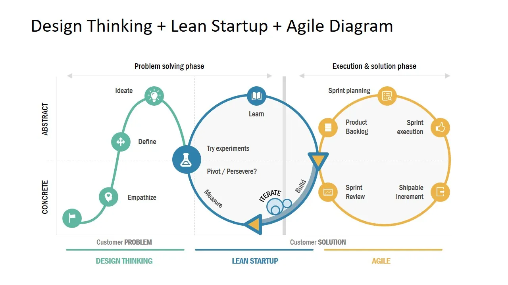

# Lean Startup: o que é e como a aplicamos na MARCO

Empreender é ter ideias, entusiasmo e muita vontade de as transformar em realidade. Mas o que acontece quando estamos tão concentrados em desenvolver o nosso produto que nos esquecemos de perguntar se o mercado realmente precisa dele?

Foi precisamente assim que a MARCO começou: uma equipa cheia de ideias, conhecimentos e motivação, mas a cometer um erro comum entre startups: começar a casa pelo telhado. Concentrámo-nos em construir aquilo que acreditávamos ser a melhor ferramenta para planear viagens, sem dedicar tempo suficiente a ouvir quem realmente a iria utilizar.

A nossa entrada na aceleradora de turismo [Turislab](https://turislab.gal/) marcou um ponto de viragem. Percebemos que empreender não é apenas desenvolver um bom produto: é também questionar as nossas próprias ideias, experimentar e aprender diretamente com o mercado.

É aqui que entra a <strong style="color: #ff7f50ff;">metodologia Lean Startup</strong>, uma forma de trabalhar que nos está a ajudar a repensar o desenvolvimento da MARCO e as decisões sobre o seu futuro.

&nbsp;

## O que é a metodologia Lean Startup?

A metodologia Lean Startup, popularizada pelo empreendedor [Eric Ries](https://theleanstartup.com/principles), propõe uma forma diferente de criar e desenvolver negócios. Em vez de passar meses a construir um produto com base apenas nas nossas intuições, incentiva-nos a verificar o mais cedo possível se as ideias respondem a necessidades reais do mercado.

A sua filosofia assenta na <strong style="color: #ff7f50ff;">aprendizagem validada</strong>: formular hipóteses, testá-las e utilizar os resultados para decidir o passo seguinte. Para isso, recorre a um ciclo de melhoria contínua conhecido como **Construir, Medir e Aprender**.

No nosso caso, esta metodologia levou-nos a repensar uma pergunta fundamental. Até então, dedicávamos grande parte do nosso esforço a imaginar novas funcionalidades para a MARCO. Mas seriam essas as funcionalidades de que os nossos futuros utilizadores realmente precisavam?

Antes de continuarmos a construir a nossa ideia do planeador de viagens perfeito, precisávamos de sair e ouvir.

&nbsp;

## Como funciona a Lean Startup? Fases e ferramentas principais

O ciclo **Construir → Medir → Aprender** não pretende lançar um produto perfeito logo à primeira. O objetivo é reduzir a incerteza através de pequenas experiências e de aprendizagens que permitam tomar melhores decisões.

O esquema seguinte situa o ciclo Lean Startup num processo de inovação mais amplo, juntamente com o Design Thinking e o desenvolvimento ágil.

### 1. Construir: transformar ideias em hipóteses

O primeiro passo é perguntar o que queremos validar e qual a forma mais simples de o fazer. Nem sempre é necessário programar uma funcionalidade completa: uma demonstração, um protótipo ou um produto mínimo viável (MVP) pode ser suficiente para recolher as primeiras reações.

Na MARCO, estamos a trabalhar com demonstrações e MVP de funcionalidades essenciais, mas também com hipóteses sobre a forma como as pessoas organizam as suas viagens e os problemas que encontram nesse processo.

### · Medir: ouvir o mercado e recolher informação

Depois, chega o momento de testar essas hipóteses. Estamos a realizar **entrevistas B2C** com viajantes, **entrevistas B2B** com profissionais do setor do turismo, **inquéritos nas redes sociais** e experiências através de **campanhas de social media**.

Cada ação permite responder a perguntas diferentes: algumas ajudam a identificar necessidades, outras mostram como as pessoas reagem a uma proposta e outras permitem explorar o interesse pelo produto.

### · Aprender: decidir o que melhorar, mudar ou abandonar

A última fase é a mais importante: interpretar os resultados sem procurar apenas aquilo que confirma o que já pensávamos.

Na MARCO, isso implica estar disponíveis para ajustar a comunicação, o onboarding e as prioridades de desenvolvimento. <strong style="color: #ff7f50ff;">Cada experiência deve ajudar-nos a tomar uma decisão</strong>, e cada decisão pode abrir caminho a um novo ciclo de aprendizagem.

&nbsp;

## Quais são as vantagens de aplicar Lean Startup numa startup?

Esta abordagem não elimina todos os riscos de empreender, mas permite enfrentá-los com mais informação e menos suposições. Entre as principais vantagens destacam-se:

- **Conhecer melhor o mercado:** perceber como se comportam os potenciais clientes, o que os preocupa e que necessidades continuam por resolver.
- **Reduzir riscos:** evitar investir meses de trabalho em soluções que poderão despertar pouco interesse.
- **Otimizar recursos:** concentrar tempo e esforço nas ideias com maior potencial para criar valor.
- **Adaptar-se rapidamente:** identificar quando é necessário melhorar uma proposta ou mudar de direção.

Na MARCO, a maior aprendizagem tem sido precisamente conhecer melhor o mercado. Passámos de imaginar como as pessoas organizam as suas viagens a perguntar-lhes diretamente como o fazem.

E esta mudança, por mais simples que pareça, está a transformar a forma como olhamos para o nosso próprio produto.

  <a
    href="https://marcotravel.io/"
    style="
      display: inline-block;
      min-width: 260px;
      background-color: #2563eb;
      color: #ffffff;
      text-decoration: none;
      padding: 18px 36px;
      border-radius: 999px;
      font-weight: 700;
      font-size: 18px;
      line-height: 1.2;
      text-align: center;
      box-shadow: 0 6px 18px rgba(37, 99, 235, 0.18);
    "
  >
    Descobre como funciona o MARCO
  </a>

&nbsp;

## Da teoria à prática: como aplicamos Lean Startup na MARCO

Desde a nossa entrada na Turislab, temos desenvolvido diferentes iniciativas para compreender melhor o mercado. Não queremos apenas confirmar que a MARCO é uma boa ideia: queremos descobrir que problemas vale a pena resolver, para quem e de que forma.

Por isso, estamos a explorar duas perspetivas complementares: a de quem organiza as suas viagens (B2C) e a dos profissionais e entidades do setor do turismo (B2B).

### B2B: oportunidades para dinamizar o turismo local

As entrevistas com profissionais e entidades do setor revelaram uma oportunidade especialmente interessante: combater a sazonalidade e criar propostas de experiências locais fora das épocas de maior procura.

Isto levou-nos a explorar como a MARCO poderá facilitar a descoberta de percursos, atividades e planos de proximidade ao longo de todo o ano, dando maior visibilidade a destinos e negócios locais.

Ainda estamos a investigar esta possibilidade. Mas é um bom exemplo de como ouvir o mercado pode abrir caminhos de negócio que não estavam no centro da nossa ideia inicial.

### B2C: o que estamos a aprender com os viajantes

Em paralelo, as entrevistas com viajantes permitiram-nos identificar alguns padrões recorrentes entre as pessoas consultadas:

- **A inteligência artificial já é bem aceite** como ferramenta para pesquisar informação e organizar viagens.
- **As redes sociais são uma importante fonte de inspiração** para descobrir destinos, locais e experiências.
- **O planeamento continua a depender de várias ferramentas:** as pessoas combinam motores de pesquisa, mapas, redes sociais, conversas e aplicações para preparar e gerir as viagens.
- **O excesso de informação e as dúvidas sobre a sua fiabilidade** estão entre as dificuldades mais frequentes.

Mas uma das descobertas mais relevantes para a nossa proposta de valor foi perceber que o planeador autónomo é mais facilmente compreendido do que as funcionalidades colaborativas, cujo valor ainda não é tão evidente à primeira vista.

Será que isto significa abandonar a colaboração? Não necessariamente. Significa dar prioridade ao planeamento individual na nossa comunicação e no onboarding, continuando a investigar quando e como a experiência em grupo pode trazer mais valor.

É precisamente esta aprendizagem que procuramos: não apenas respostas que confirmem as nossas ideias, mas informação capaz de mudar as nossas decisões.

&nbsp;

## O que aprendemos até agora?

Se esta experiência nos está a ensinar alguma coisa, é que empreender não significa ter todas as respostas, mas aprender a fazer as perguntas certas.

Ainda temos muito para aprender. Vamos continuar a explorar oportunidades, a testar hipóteses e a adaptar a ferramenta às necessidades reais dos viajantes e dos profissionais do turismo.

Porque o nosso objetivo mantém-se: tornar o planeamento de viagens mais fácil, intuitivo e divertido. O que está a mudar é o caminho que seguimos para lá chegar.

E tu, como organizas as tuas viagens? Gostávamos de conhecer a tua experiência e continuar a aprender com quem está do outro lado do ecrã.

  <a
    href="https://marcotravel.io/"
    style="
      display: inline-block;
      min-width: 260px;
      background-color: #2563eb;
      color: #ffffff;
      text-decoration: none;
      padding: 18px 36px;
      border-radius: 999px;
      font-weight: 700;
      font-size: 18px;
      line-height: 1.2;
      text-align: center;
      box-shadow: 0 6px 18px rgba(37, 99, 235, 0.18);
    "
  >
    Experimenta o MARCO e partilha a tua opinião
  </a>

